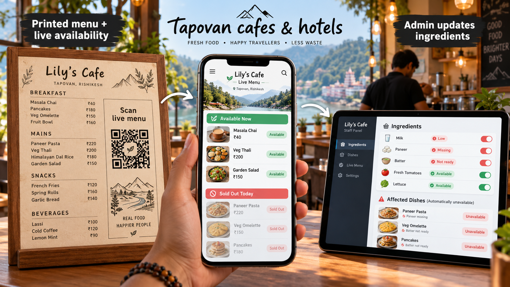

# Tapovan Menu

Tapovan Menu is a live-menu platform for cafes, restaurants, hostels, and hotels. Customers scan a QR code beside the printed menu and see what is actually available right now. Staff update ingredients or dishes from a simple admin panel, and affected dishes become unavailable automatically.

## Why this exists

Printed menus do not change during the day, but real availability changes constantly. Milk runs low, paneer is missing, batter is not ready, a machine stops working, or a chef pauses a dish. Customers still ask for those items because they are printed on the menu.

Tapovan Menu keeps the printed menu, but adds a live QR layer.

## Core flow

1. Cafe keeps its normal printed menu.
2. Cafe places a QR sticker or table stand beside it.
3. Customer scans the QR code.
4. Customer sees the live menu for that cafe.
5. Staff marks ingredients or dishes unavailable from the admin panel.
6. The public menu updates immediately.

## Product model

This is one platform for many cafes, not a separate app for every cafe.

Example URLs:

- `tapovanmenu.com/lilys-cafe`
- `tapovanmenu.com/ganga-view-cafe`
- `tapovanmenu.com/hostel-rooftop-kitchen`

Each cafe gets:

- Unique QR code
- Public live menu page
- Admin panel
- Menu categories and dishes
- Ingredient availability controls
- Optional custom branding

## Documents

- [Idea document](Tapovan-Menu-idea-doc.md)
- [Flow diagram](docs/flow-diagram.md)
- [MVP build plan](docs/mvp-build-plan.md)

## Demo pitch line

> Your printed menu stays the same. Customers scan QR to see what is actually available right now.
