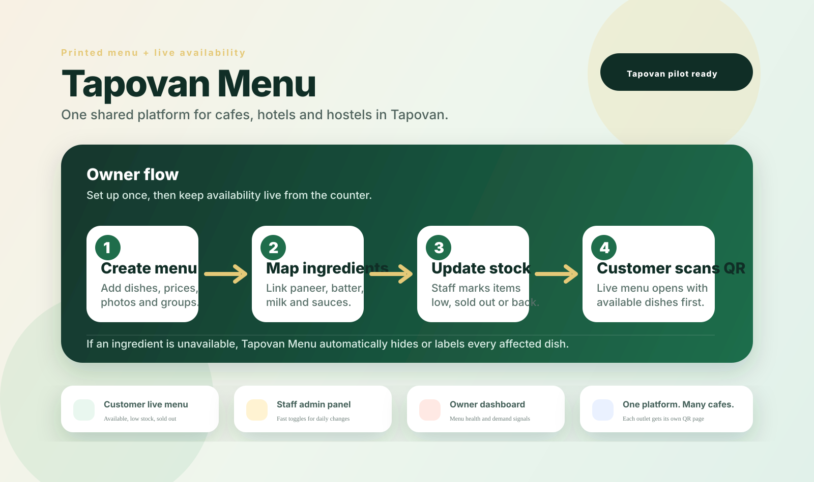

# Tapovan Menu

Tapovan Menu is a live-menu platform for cafes, hotels, hostels, and restaurants. Customers scan a QR code beside the printed menu and see what is actually available right now. Staff update ingredients or dishes from a simple admin panel, and affected dishes become unavailable automatically.

A polished cafe-scene concept mockup is also saved at [assets/tapovan-menu-professional-flow.png](assets/tapovan-menu-professional-flow.png), and the earlier pitch mockup is saved at [assets/tapovan-menu-pitch-mockup.png](assets/tapovan-menu-pitch-mockup.png).

## Why this exists

Printed menus do not change during the day, but real availability changes constantly. Milk runs low, paneer is missing, batter is not ready, a machine stops working, or a chef pauses a dish. Customers still ask for those items because they are printed on the menu.

Tapovan Menu keeps the printed menu, but adds a live QR layer.

## Core flow

1. Owner creates one Tapovan Menu outlet profile.
2. Staff digitizes the printed menu with categories, dishes, prices and photos.
3. Staff maps ingredients like paneer, batter, milk or bread to affected dishes.
4. Cafe places a QR sticker or table stand beside the printed menu.
5. Customer scans the QR code and sees available dishes first.
6. Staff updates ingredients or dishes from the admin panel during the day.
7. The public live menu updates immediately, including every dish affected by a missing ingredient.

## Product model

This is one platform for many cafes, not a separate app for every cafe.

Example URLs:

- `tapovanmenu.com/lilys-cafe`
- `tapovanmenu.com/ganga-view-cafe`
- `tapovanmenu.com/hostel-rooftop-kitchen`

Each cafe gets:

- Unique QR code
- Public live menu page
- Admin panel
- Menu categories and dishes
- Ingredient availability controls
- Optional custom branding

## Documents

- [Idea document](Tapovan-Menu-idea-doc.md)
- [Professional product flow](docs/product-flow.md)
- [Design brief](docs/design-brief.md)
- [Flow diagram](docs/flow-diagram.md)
- [MVP build plan](docs/mvp-build-plan.md)

## Demo pitch line

> Keep your printed menu. Tapovan Menu makes availability live.
