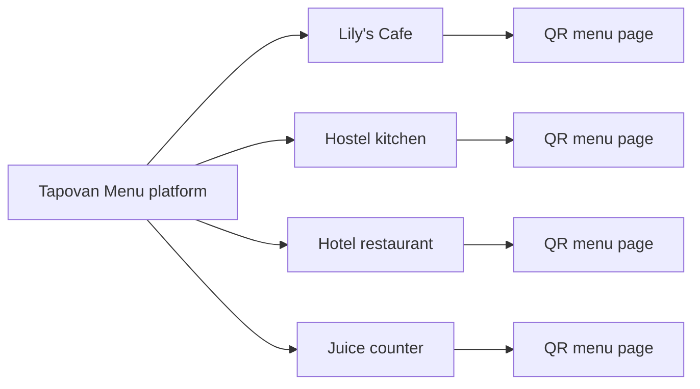

# Tapovan Menu product flow

Tapovan Menu is a shared live-menu platform for cafes, hotels, hostels and small restaurants. The business keeps its printed menu, but the QR beside it opens a live page where guests see what is actually available right now.

## Core product loop

1. **Create the outlet**  
   The owner adds the cafe/hotel profile, location, opening hours, logo and contact details.

2. **Digitize the printed menu**  
   Staff adds categories, dishes, prices, photos, tags and dietary notes. This mirrors the printed menu so the QR feels familiar.

3. **Map ingredients to dishes**  
   Common dependencies like paneer, batter, milk, tomato, bread or coffee beans are linked to every affected dish.

4. **Generate the QR menu**  
   Tapovan Menu creates a QR poster/table standee for that outlet. The printed menu can stay fixed; the QR page stays live.

5. **Update availability during the day**  
   Staff marks ingredients or dishes as available, low stock, sold out, paused or back soon. One ingredient update can automatically affect many dishes.

6. **Customer scans and orders confidently**  
   Guests scan the QR and first see the cafe/restaurant name, area, live status, and then available dishes. Sold-out dishes are faded with a reason, so staff get fewer repeated questions.

7. **Owner reviews demand**  
   The dashboard shows scans, most-viewed dishes, unavailable items, frequent missing ingredients and lost-demand signals.

## Admin information architecture

- **Dashboard**: today’s live status, quick toggles, recent customer scans and unavailable dish count.
- **Outlets**: one owner can manage multiple cafes, hostel kitchens, hotel restaurants or counters.
- **Menus**: categories, dishes, prices, photos, food type, prep time and tags.
- **Ingredients**: ingredient list, current availability, low-stock notes and affected dishes.
- **Availability**: fast daily operation screen for staff.
- **QR posters**: printable QR sheets, table stickers and counter cards.
- **Analytics**: scan trends, sold-out history, popular dishes and missed-demand insights.
- **Settings**: staff access, language, branding and contact/order links.

## Customer live menu header

The customer page should always begin with outlet identity before showing food items:

- **Cafe/restaurant name:** for example, Lily’s Cafe.
- **Area/branch:** for example, Tapovan, Rishikesh.
- **Live status:** Open now, closed, updated 2 minutes ago, or kitchen paused.
- **Trust cue:** “Live menu by Tapovan Menu.”

This matters because Tapovan Menu is one shared platform. The QR route identifies the outlet technically, but the UI must confirm it visually for the guest.

## Customer live menu states

| State | Guest sees | Staff action |
| --- | --- | --- |
| Available | Normal card with price and photo | No action needed |
| Low stock | Small “Few left” label | Prepare backup or update later |
| Sold out today | Faded card with reason | Mark ingredient or dish unavailable |
| Back soon | Dish visible with return note | Add expected time |
| Cafe closed | Menu visible but ordering/contact CTA changes | Opening hours control |

## One platform, many businesses

Tapovan Menu should not become a separate app for every cafe. It is one platform where every business gets its own profile, QR code and live menu URL.

## Demo flow for Vaibhav

1. Show the printed menu with a Tapovan Menu QR sticker.
2. Open the customer menu and show “Available Now” first.
3. Switch to the admin panel and mark **Paneer** as missing.
4. Show paneer dishes automatically moving to unavailable.
5. Mark Paneer back as available.
6. Show the customer menu updating again.
7. End with the owner dashboard: scans, unavailable dishes and missed-demand insights.

## Why cafes will care

- Staff spend less time saying “ye available nahi hai”.
- Guests avoid disappointment after reading a printed menu.
- Owners can keep printed menus but still operate dynamically.
- Sold-out patterns reveal what ingredients or dishes cause the most lost demand.
- Tapovan’s dense cafe/hotel area makes this useful as a local SaaS network.
