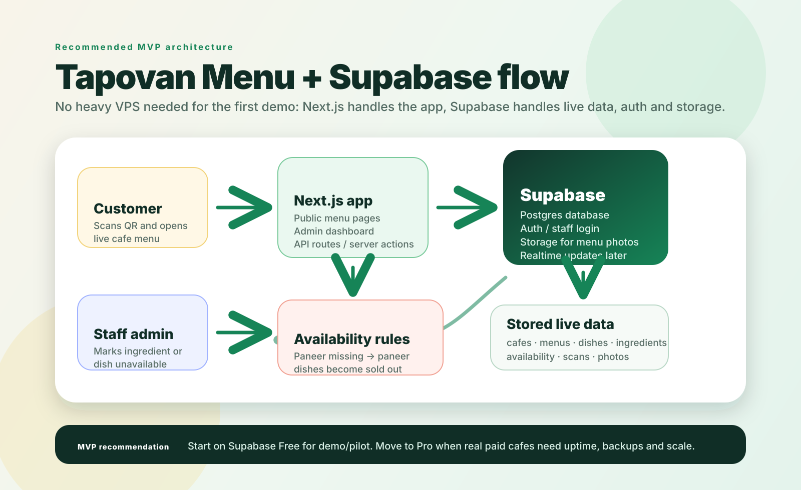
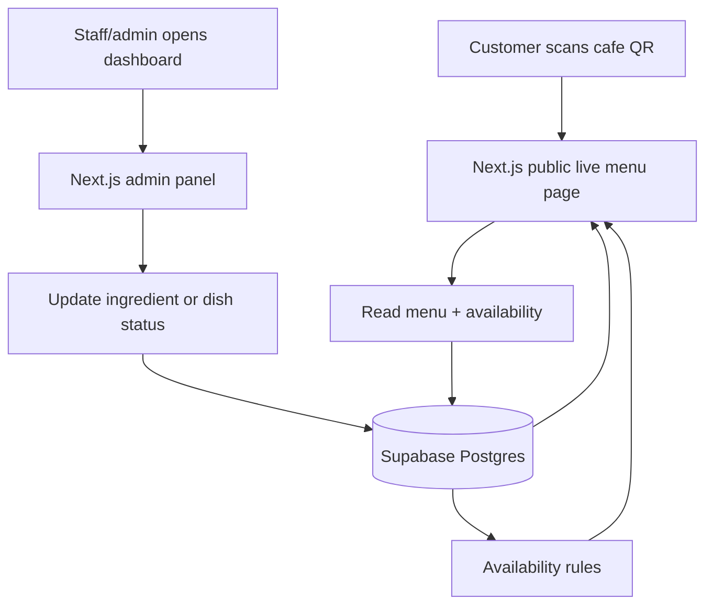

# Tapovan Menu Supabase architecture

Tapovan Menu can start without a heavy VPS. For the MVP, Supabase can handle database, staff auth, file storage and later realtime updates. The app can run as a Next.js website with API routes/server actions.

## Recommended MVP stack

| Layer | Tool | Why |
| --- | --- | --- |
| Customer + admin app | Next.js | Public QR menu pages and admin panel in one codebase |
| Backend/API | Next.js API routes or server actions | Keeps MVP simple without maintaining a separate server |
| Database | Supabase Postgres | Stores cafes, menus, dishes, ingredients and live availability |
| Staff login | Supabase Auth or PIN table | Fast owner/staff access |
| Menu photos | Supabase Storage | Store dish photos and cafe logos |
| Hosting | Vercel | Simple deploy for the Next.js app |
| Realtime updates | Supabase Realtime later | Useful once cafes want instant screen refresh |

## Data flow

## Core tables

| Table | Purpose |
| --- | --- |
| `outlets` | Cafe/hotel/hostel profile, slug, location, logo, status |
| `staff_users` | Owner/manager/staff access for each outlet |
| `menu_categories` | Breakfast, mains, drinks, snacks |
| `dishes` | Dish name, price, category, photo, manual status |
| `ingredients` | Paneer, milk, batter, bread, tomatoes, etc. |
| `dish_ingredients` | Mapping between dishes and required ingredients |
| `availability_events` | History of sold-out/available updates |
| `qr_scans` | Scan analytics per outlet and time |

## Why Supabase Free is enough for demo

The first demo mainly stores small text records: cafe names, menu items, ingredient toggles and scan events. Supabase Free is enough for a proof of concept and a few pilot cafes. Move to Pro when Tapovan Menu has paying cafes and needs stronger uptime, backups and scale.

## Server decision

Tapovan Menu still needs backend logic, but it does not need a separate VPS at the start. Supabase + Next.js can provide the server-side behavior for the MVP:

- fetch live menu by cafe slug
- update ingredient and dish status
- calculate affected dishes
- save scan analytics
- manage staff login
- store menu images

A separate VPS can be added later only if custom workers, heavy integrations, or high traffic make it necessary.
